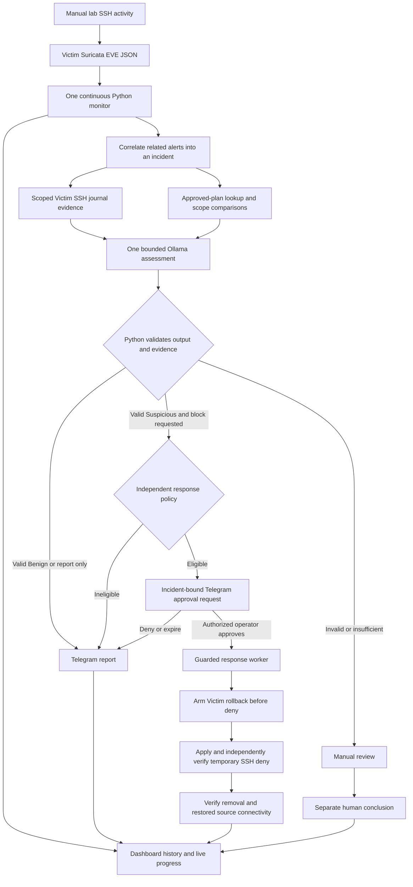
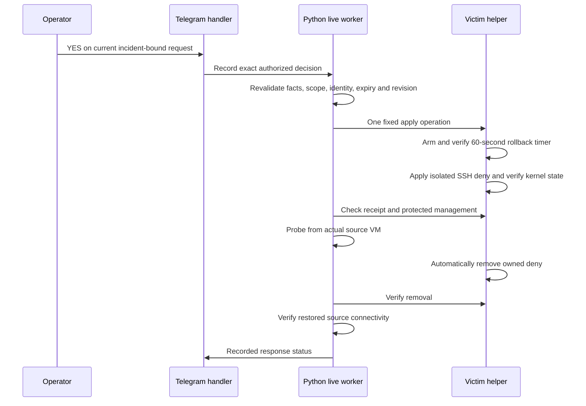

# Windows SOAR Investigation Lab — WSL2, Hyper-V and Ollama

[](https://github.com/mashaojin/soar-investigation-windows/actions/workflows/tests.yml)

**soar-investigation-windows** is a Windows-focused, Python-led lab that turns **Suricata alerts into evidence-based investigations, dashboard records and human-approved responses**.

This is a separate repository derived from [soc-pipeline](https://github.com/mashaojin/soc-pipeline). Its default `main` branch contains the Windows project; users do not need to select a Windows branch in the original Mac repository. Upstream compatibility modules/tests are retained without changing the original repository.

**Suricata → Python correlation and SSH evidence → one bounded Ollama assessment → Python validation → Telegram decision → optional temporary SSH deny with victim-side rollback.**

The model assesses evidence. Python owns collection, validation and response policy. A human approves each eligible firewall response. This is an educational lab, not a production security product.

> **Windows status:** the WSL2/Hyper-V port is implemented and tested, but Gemma3:1b investigation quality is unreliable. Actual manual firewall enforcement and automatic rollback passed; the complete valid-assessment → Telegram YES → live-worker path is still unverified on Windows. See [verification limits](#verification-status).

## Contents

- [Workflow and decision boundaries](#workflow)
- [Dashboard and Telegram screenshots](#screenshots)
- [Windows lab requirements](#windows-lab-requirements)
- [Quick start](#quick-start)
- [Configuration and credentials](#configuration-and-credentials)
- [Three manual scenarios](#three-manual-scenarios)
- [Telegram decisions and live response](#telegram-decisions)
- [Stop, restart and recovery](#stop-restart-and-recovery)
- [Verification and troubleshooting](#verification-status)
- [Documentation and repository layout](#documentation)

## Workflow



### Responsibilities

| Component | Responsibility | Cannot authorize |
| --- | --- | --- |
| Suricata | Connection-threshold evidence | Password outcomes, malicious intent or a block |
| Python collector | Continuous ingestion, cursor handling and incident correlation | An AI verdict |
| Evidence/plan layer | Scoped authentication outcomes, coverage and authorization comparisons | A security classification |
| Configured Ollama model | Verdict, explanation and recommended next step | Tool execution, shell commands or firewall changes |
| Python validators/policy | Check structure, facts, coverage, attribution and response eligibility | Human approval |
| Telegram operator | Approve/deny one exact eligible response, or record a separate human review | Reuse an expired/stale approval |
| Victim helper | Fixed scoped deny and rollback operations | Arbitrary model-generated commands |

The model can choose **Benign**, **Suspicious** or **Insufficient Evidence**, and recommend **Report only**, **Request more evidence** or **Request block approval**. Inputs are not predetermined verdicts. Suspicious alone does not offer a block: the recommendation and independent Python checks must also pass.

## Screenshots

These are actual, cropped screenshots from the **original Mac/UTM lab**. They illustrate the shared dashboard and Telegram workflow, not proof of a completed Windows Telegram-to-worker live response. No Windows screenshots or synthetic messages are presented as successful live enforcement.

### Dashboard


The dashboard preserves readable incident numbers, timestamps, grouped alerts, AI assessments, independent human conclusions and response progress. Monitor health is checked by heartbeat, separately from saved database state.

<details>
<summary>Test-plan editor and incident assessment</summary>


*An unsaved plan-editor example. Test-plan approval defines authorized activity; it does not approve a firewall response.*


*Recorded Mac/UTM assessment and response example. The configured model and selected platform are explicit in the Windows profile.*

</details>

### Telegram

| Original live-response completion | Original manual-review notice |
| --- | --- |
|  |  |

The live screenshot shows a completed historical response, so its pending approval buttons are no longer displayed. Current eligible live requests offer **YES — Approve LIVE 60s block** and **NO — Deny block / report only**. Current manual-review notices offer **Benign / Suspicious / Need more evidence**. Screenshot provenance and limits are documented in [SCREENSHOTS.md](docs/SCREENSHOTS.md).

## Windows lab requirements

| Component | Requirement |
| --- | --- |
| Host | Windows 11 Pro with Hyper-V; 16 GB RAM lab tested |
| Python | WSL2 Ubuntu, Python 3.12+; **not native Windows Python** |
| Inference | Ollama on Windows; explicit endpoint and model identity |
| Default example model | gemma3:1b, 8,192 context and 1,024 output budget; known quality failures remain documented |
| Victim | Ubuntu guest with SSH, Suricata/EVE and readable scoped SSH journal evidence |
| Trust-Client | Ubuntu guest for approved tests and account-scope scenarios |
| Attacker | Kali guest for the controlled unapproved scenario |
| Transport | WSL OpenSSH with verified keys; Windows process bridge and PowerShell 7; Windows curl.exe for loopback Ollama |
| Optional live response | Reviewed fixed Victim SSH helper, nftables and systemd rollback; one human approval per eligible response |

Python uses the standard library: there is no pip installation step. Node is used for development/CI syntax checks, not the Python dashboard. Initialization does not install guest services, grant access or provision privileged helpers. Inspect existing software before installing anything. On a 16 GB host, run only the guests required for a scenario and monitor memory during inference.

Public addresses are examples, not discovery. Verify guest masks, routes, usernames and console host-key fingerprints. Protect the real management source as observed by Victim. Hyper-V Default Switch DHCP addresses can change after reboot; revalidate identities and scope before collecting or responding.

This repository's setup path is Windows/WSL2/Hyper-V. Legacy Mac defaults and tests remain for upstream compatibility; Mac deployment instructions belong to the [original project](https://github.com/mashaojin/soc-pipeline).

## Quick start

### 1. Obtain and test the source

Clone this Windows repository; the default branch is `main`:

```sh
git clone https://github.com/mashaojin/soar-investigation-windows.git
cd soar-investigation-windows
python3 -m unittest discover -s tests -q
```

For a private repository, authenticate locally through GitHub CLI or Git Credential Manager with an authorized account. Never paste an access token into chat, source or a command saved in the repository.

Offline tests use synthetic fixtures, temporary databases and mocked external services. They do not need VMs, a model or Telegram credentials and dispatch no real firewall actions. Passing them does not establish model quality or live deployment compatibility.

### 2. Configure the selected platform

Execute the following **inside WSL**, then follow the staged [Windows guide](docs/WINDOWS.md):

```sh
python3 configure_local.py --profile windows-hyperv
```

Always select `--profile windows-hyperv` for this lab. The unqualified initializer retains upstream defaults for compatibility.

Review the newly created private files. Keep lab/runtime model settings consistent. Configure actual guest identities, protected management, strict SSH trust and sensor access before starting collection. Do not copy historical databases, plans, approvals or cursors from a different installation.

### 3. Start the dashboard and collection

For Windows, use two WSL terminals in the repository root:

```sh
# Terminal 1: dashboard only
python3 windows_lab.py dashboard
```

```sh
# Terminal 2: continuous collection; model assessment deferred
python3 windows_lab.py monitor --collection-only
```

Open [http://127.0.0.1:8765](http://127.0.0.1:8765) in the Windows browser. Check monitor/component health, not HTTP availability alone. **The dashboard does not start the collector, model worker or Telegram polling.**

After the relevant prerequisites and assessment-mode authorization are complete, replace collection-only mode with the appropriate command from [Windows operating modes](docs/WINDOWS.md#8-select-an-explicit-assessmentresponse-mode). Never run two monitors against the same database or two pollers for the same bot.

## Configuration and credentials

| Local file | Purpose |
| --- | --- |
| lab.local.json | Platform, guest identities, management addresses, timezone and Ollama settings |
| live.ssh.local.json | EVE collection scope, cursor initialization and polling |
| runtime.ssh.live.local.json | Evidence enrichment, plan registry and assessment-mode settings |
| response.local.json | Dry-run/live mode, restrictions, helper receipts and approval policy |
| .env | Telegram token and private chat/operator IDs, read as local literal data |
| plans/dashboard-plans.json | Actual local test plans |
| SQLite databases | Incidents, analysis, reviews, prompt history and operational cursors |

All operational files are ignored. `configure_local.py` creates absent defaults and preserves existing state; it does not silently reset a live installation. Public examples live in `config/`. The Mac topology and Windows examples remain separate.

For Telegram, create/use a bot locally, obtain its token through BotFather, and identify your private chat/operator ID. Copy `.env.example` to `.env` and replace its placeholders locally. The Windows launcher accepts `--env-file .env`; it never executes that file as shell code. Confirm no other program polls the bot before setting the local exclusive-polling flag. Authorize a test notification separately. Never publish tokens, private keys, actual authorization records, plan registries or incident databases.

A dedicated SSH key and console-verified host keys are required for guest access. The Windows bridge opens no listening port and does not change firewall exposure. Privileged Victim helpers must be prepared, reviewed, explicitly installed and independently verified; see [the helper setup](docs/WINDOWS.md#7-prepare-and-review-privileged-helpers).

## Three manual scenarios

Start with dry-run responses and verify each stage before continuing. Run attempts yourself, once per authorized rehearsal. Do not use the demo helper against systems you do not control.

| Scenario | Manual activity | Evidence-dependent interpretation | Possible Telegram path |
| --- | --- | --- | --- |
| Approved test | Trust-Client uses soc_test inside an approved window and limit | Benign when evidence supports the plan | Report only |
| Unapproved activity | Kali makes bounded SSH attempts with no matching approved plan | Suspicious if the observed context supports that conclusion; no plan alone is not proof of attack | Eligible block approval, report only or manual review |
| Scope violation | Trust-Client attempts root while its plan permits only soc_test | Recorded root attempt is outside account scope; model assesses its significance | Eligible block approval, report only or manual review |

Create a plan on the dashboard with **New test plan → Validate → Approve plan**. Review source, target, permitted account, failure limit and future window. Test-plan approval is separate from response approval.

Once client inputs have been staged and readiness verified, use the appropriate command **on the named VM**, within the reviewed timing:

```sh
# Trust-Client: approved test
python3 ~/soc-demo/ssh_demo_client.py --mode approved --execute --lab-config ~/soc-demo/lab.local.json
# Kali: controlled unapproved scenario
python3 ~/soc-demo/ssh_demo_client.py --mode unapproved --execute --lab-config ~/soc-demo/lab.local.json
# Trust-Client: deliberate account-scope violation
python3 ~/soc-demo/ssh_demo_client.py --mode scope-violation --execute --lab-config ~/soc-demo/lab.local.json
```

The helper checks its route source, uses strict host-key checking and makes six bounded deliberately failed attempts, with a pause between bursts. Scope-violation mode uses one root and five soc_test attempts. It stops on unexpected success. Verify actual Victim authentication evidence; Permission denied on the client does not prove all six failures were logged.

Python waits for the complete correlation/plan evidence window plus arrival margin before assessment. Approvals and readable incident IDs are local to the current installation. Use [Windows setup](docs/WINDOWS.md) for client staging, scenario readiness and mode-specific commands. Legacy demonstration documentation is retained as upstream reference only.

## Telegram decisions

### Response approval

An eligible Suspicious assessment with a supported block recommendation can ask:

> Do you authorize blocking this source from accessing the victim's SSH service for 1 minute?

- **YES — Approve LIVE 60s block:** revalidate the exact request and dispatch one guarded response.
- **NO — Deny block / report only:** retain the report and record denial; no block.
- **No answer:** expire the request after 10 minutes; no block.

In dry-run mode, the buttons explicitly say dry run and record simulation only. Activating live mode is a separate reviewed configuration decision; a test plan or human conclusion is not that authorization. Windows supports an explicit experimental review-only mode and a separately authorized human-approved live mode that records acceptance of known model limitations without falsely marking model evaluation passed.



The response targets the source IP's access to **Victim TCP/22**, not all traffic. It can interrupt permitted SSH tests from that same client. Management and Victim addresses are protected. The helper accepts fixed operations rather than commands generated by the model. The worker checks actual client connectivity and handles uncertain execution without blindly redispatching.

### Manual investigation review

Insufficient evidence, model requests for more evidence and validation errors lead to **Benign / Suspicious / Need more evidence**. These save a separate human conclusion. They never authorize a firewall change or overwrite the AI assessment. Need more evidence keeps the case open for operator investigation; it does not automatically launch another model call.

If model output is rejected, there is **no accepted AI verdict**, even if raw output contained a label. The technical details retain the original output/error. Do not reinterpret a rejected assessment as an eligible live response.

## Stop, restart and recovery

For foreground dashboard/monitor terminals, press Ctrl-C and wait for exit before restarting with the same command and mode flags. Preserve the database/cursor across ordinary restarts. The monitor owns one continuous collector and one Telegram polling handler.

Keep Victim running during any live block: rollback runs on Victim independently of WSL, the dashboard and Telegram. If dispatch is interrupted or uncertain, inspect the recorded run/helper state and do not repeat apply. Recovery uses the fixed helper's rollback operation for that recorded run ID; never flush unrelated firewall rules to clear a demo block.

After a guest reboot, reverify DHCP addresses, routes and host-key identity. Changed scope requires reviewing active/staged configuration and the root-owned helper configuration, then independently verifying it before live response.

## Verification status

| Check | Windows result |
| --- | --- |
| Clean-checkout offline suite | **292 tests passed** |
| JavaScript, PowerShell syntax and Git whitespace | Passed |
| Publication audit | Passed for candidate source/docs; also tested with rejection controls |
| Strict-key guest transport, sensor/journal evidence and Windows Ollama | Verified in the lab |
| Three manual scenario/review workflows | Verified |
| Real manual helper deny, protected management and automatic rollback | Verified; approximately 60.43 seconds |
| Valid assessment → actual Telegram YES → live-worker enforcement | **Not yet verified**; recent Gemma3 outputs failed validation |
| Reliable security judgment | **Not established** |

### Reproduce software checks

```sh
python3 -m unittest discover -s tests -q
node --check web/app.js
node --check web/experiments.js
python3 tools/check_release.py
git diff --check
```

GitHub Actions runs the offline tests, publication audit and JavaScript syntax checks. It does not run guest traffic, model evaluation, Telegram or live firewall enforcement.

For actual-model synthetic evaluation:

```sh
python3 verify_gemma.py --output verification-model-base.json
python3 evaluate_model_boundaries.py --output verification-model-boundaries.json
```

Candidates can override model, thread count or instruction file for evaluation only. Preserve full evidence, context accounting, timeouts and validators. Distinguish valid JSON from correct judgment. No single successful response qualifies a model, and repeatedly generating incidents until a desired verdict appears is not verification.

### Common problems

| Symptom | Check |
| --- | --- |
| Dashboard loads but no incidents arrive | Monitor heartbeat, collector errors, EVE access, rule SID/interface and actual guest routes |
| SSH worked before reboot | Current DHCP address and console fingerprint; never disable host checking |
| WSL cannot reach Windows Ollama | Configured Windows loopback stdio transport; WSL localhost is not assumed equivalent |
| Telegram messages absent | Locally configured bot/chat identity, exclusive polling and current handler health; never expose the token |
| Root attempt not shown | Actual scoped Victim journal, account counts, time window and SSH protections, not client output alone |
| No live buttons | Verdict/recommendation, validation error, Python eligibility, selected mode and fresh activation gate |
| Block request rejected | Current operator/message/revision/evidence/status/expiry bindings; create no historical approval shortcuts |
| Model says data is missing despite collected facts | Preserve rejected output and perform synthetic offline diagnosis; do not disable fact or coverage checks |

## Documentation

- [Windows / WSL2 / Hyper-V setup](docs/WINDOWS.md)
- [Upstream Mac project](https://github.com/mashaojin/soc-pipeline) — separate project; legacy reference docs in this checkout are not the Windows setup path
- [Three-scenario demonstration](docs/DEMO.md)
- [Architecture and decision boundaries](docs/ARCHITECTURE.md)
- [Settings, reviews and operations](docs/OPERATIONS.md)
- [Screenshot provenance](docs/SCREENSHOTS.md)
- [Model evaluation](docs/WINDOWS_MODEL_EVALUATION.md), [Qwen3 evaluation](docs/WINDOWS_QWEN3_EVALUATION.md), [prompt diagnosis](docs/WINDOWS_PROMPT_DIAGNOSIS.md), [cloud probe](docs/WINDOWS_CLOUD_EVALUATION.md)
- [Repository and publication rules](docs/REPOSITORY.md)

```text
soar-investigation-windows/
├── configure_local.py       # Initialize absent private configuration
├── monitor.py               # Continuous collection, analysis and response orchestration
├── dashboard.py             # Loopback dashboard and protected APIs
├── *.py                     # Evidence, validation, transports and bounded helpers
├── config/                  # Public platform/configuration examples
├── docs/                    # Setup, architecture, screenshots and measured results
├── fixtures/                # Deterministic synthetic observations
├── plans/                   # Actual local registry is ignored
├── prompts/                 # Exported instructions and candidates
├── rules/                   # Example Suricata SSH rule
├── tests/                   # Offline regressions; no live enforcement
├── tools/check_release.py   # Read-only publication audit
├── web/                     # Dashboard assets
└── .github/workflows/       # Offline CI
```

Credentials, private keys, actual approval/plan registries, incident databases, logs, machine-specific profiles and local diagnostic archives are excluded. Reproduce from the Git checkout, not by copying an operator's surrounding workspace. Repository visibility and licensing are not changed by this port.
